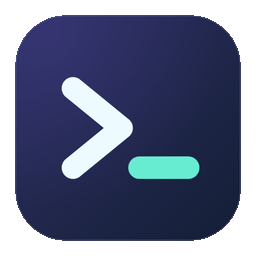

<p align="center">
  
</p>

<h1 align="center">ztabb</h1>

<p align="center">
  <b>A fast, tiny terminal in one native process.</b><br>
  Low idle CPU · about 10 MB on disk · no Electron, no SDL3 install.<br>
  macOS · Linux · Windows
</p>

<p align="center">
  <a href="#install">Install</a> ·
  <a href="#features">Features</a> ·
  <a href="#keys">Keys</a> ·
  <a href="#build-from-source">Build</a>
</p>

---

## Install

```sh
curl -fsSL https://raw.githubusercontent.com/alaleks/ztabb/master/install.sh | sh
```

The installer picks the right build, checks its SHA-256 and installs it to
`/Applications` (macOS) or `/usr/local` (Linux). Pin a version with
`ZTABB_VERSION`, change the location with `ZTABB_PREFIX`.

<details>
<summary>Manual download</summary>

Grab a file from the [latest release](https://github.com/alaleks/ztabb/releases/latest)
(`checksums.txt` holds the SHA-256 of each):

| File                        | For                         |
| --------------------------- | --------------------------- |
| `ztabb-aarch64-macos.zip`   | macOS, Apple Silicon (.app) |
| `ztabb-x86_64-macos.zip`    | macOS, Intel (.app)         |
| `ztabb-x86_64-linux.tar.gz` | Linux x86_64                |
| `ztabb-x86_64-windows.zip`  | Windows x86_64              |

- **macOS:** move `ztabb.app` to `/Applications`. SDL3 is linked into its
  executable. The app is ad-hoc signed, so on first launch right-click →
  **Open**, or run
  `xattr -dr com.apple.quarantine /Applications/ztabb.app`.
- **Linux:** the executable includes SDL3; no separate SDL3 installation is
  needed for releases built from this source. Older releases may still need it.
- **Windows:** unpack the zip and run `ztabb.exe`. Older releases may contain
  `SDL3.dll` beside it; releases built from this source include SDL3 in the exe.

</details>

## Features

- **Tabs and panes** — split in any direction, move focus with arrows.
- **Full VT/xterm emulation** — alternate screen, scroll regions, 256 colours
  and truecolor, bracketed paste, mouse reporting.
- **Re-wraps on resize** — history included.
- **SSH in one keystroke** — hosts come from `~/.ssh/config`. A dropped
  connection keeps its tab and history; Enter reconnects.
- **Command colouring** — the line you are typing is syntax-highlighted.
- **Light and dark themes** — switch live; text already on screen recolours.
  Every colour pair is WCAG-checked.
- **JetBrains Mono built in** — with Powerline glyphs, so `agnoster` and
  `powerlevel10k` work without a Nerd Font.

## Why it is light

Measured on Apple Silicon against Tabby running alongside:

|           | ztabb      | Tabby  |
| --------- | ---------- | ------ |
| Memory    | **110 MB** | 459 MB |
| Processes | **1**      | 5      |
| On disk   | **≈10 MB** | 379 MB |

A rough comparison, not a benchmark. Most of the 110 MB is the SDL window and
Metal renderer themselves (88 MB empty); ztabb's own share is about 23 MB.

- Redraws only when something changes — no 60 fps of a motionless prompt.
- 16 bytes per cell, 63 KB for a new tab, a 4 MB cap on each tab's history.
- Zero allocations in the render loop.

## Keys

The modifier is **Cmd** or **Ctrl+Shift** — both work everywhere. Plain Ctrl
stays with the shell.

| Key                         | Action                         |
| --------------------------- | ------------------------------ |
| `Cmd+T` / `Cmd+N`           | New tab                        |
| `Cmd+D` / `Cmd+E`           | Split right / down             |
| `Cmd+←→↑↓`                  | Move between panes             |
| `Cmd+W`                     | Close pane                     |
| `Cmd+1…9`, `Cmd+[` `]`      | Switch tab                     |
| `Cmd+S`                     | SSH hosts                      |
| `Cmd+Y`                     | Light / dark                   |
| `Cmd+L`                     | Command colouring on / off     |
| `Cmd+=` `-` `0`             | Font size up / down / reset    |
| `Cmd+C` / `Cmd+V`           | Copy / paste                   |
| `Shift+PageUp` / `PageDown` | Scroll history                 |

- **Ctrl+C** copies when there is a selection, interrupts otherwise.
- **Shift+drag** selects text while a program (vim, an agent) owns the mouse.
- **Right-click** opens a menu: copy, paste, split, close.
- `ZTABB_THEME=light ztabb` starts in the light theme.

## Build from source

Requires **Zig 0.17.0**. For a quick local build, install SDL3 first
(`brew install sdl3` on macOS; `sh tools/install-sdl3-linux.sh` on Linux):

```sh
zig build run
zig build test
```

For a macOS or Linux executable that includes SDL3, install Git, CMake and
Ninja. On Debian or Ubuntu, also install the X11 and Wayland development
packages used by the release build:

```sh
sudo apt-get install -y libx11-dev libxext-dev libxrandr-dev \
  libxcursor-dev libxfixes-dev libxi-dev libxss-dev libxtst-dev \
  libwayland-dev wayland-protocols libxkbcommon-dev libegl1-mesa-dev
```

An installed SDL3 is not needed for this build:

```sh
sh tools/build-static-sdl3.sh
zig build -Doptimize=ReleaseFast -Dsdl3-static=zig-out/sdl3-static/lib/libSDL3.a
```

On macOS, package that executable as an app with
`zig build bundle -Doptimize=ReleaseFast -Dsdl3-static=zig-out/sdl3-static/lib/libSDL3.a`.

On Windows, use `vcpkg install sdl3:x64-windows-static`, then
`zig build -Dtarget=x86_64-windows-msvc -Dsdl3-static=<vcpkg>/installed/x64-windows-static/lib/SDL3-static.lib`.

<details>
<summary>Artwork and typeface</summary>

```sh
zig build icon     # zig-out/ztabb.icns
zig build logo     # .github/logo.gif (needs ffmpeg)
```

Re-baking the font is only needed to change the character set. It requires
macOS and JetBrains Mono installed:

```sh
cc -O2 -o /tmp/genfont tools/genfont.c -lm \
   -framework CoreText -framework CoreGraphics -framework CoreFoundation
/tmp/genfont       # writes src/font.dat and src/font_data.zig
```

</details>

## Roadmap

- [x] Tabs, panes, SSH, themes, command colouring
- [x] Selection, bracketed paste, re-wrap on resize
- [ ] Custom themes and key bindings from a config file

## Licence

MIT — see `LICENSE` — except `src/font.dat`, `src/font_data.zig` and the glyph
data compiled from them, which are derived from JetBrains Mono and are
**OFL 1.1**. Release binaries also include SDL3 under its own licence.
See `NOTICE`, `licenses/JetBrainsMono-OFL.txt` and `licenses/SDL3.txt`.
